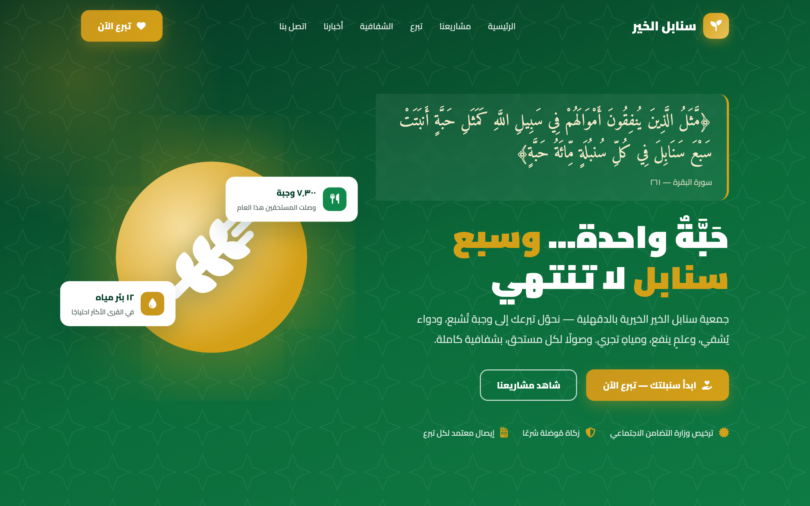
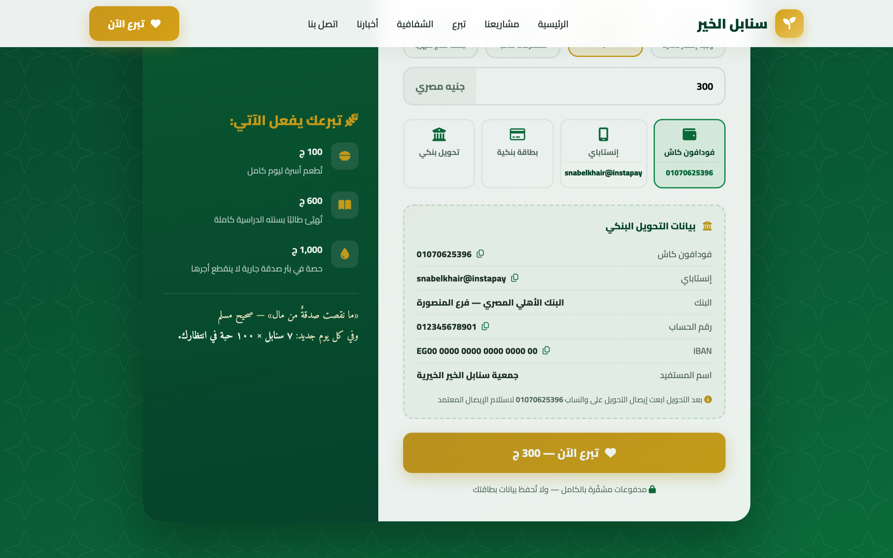
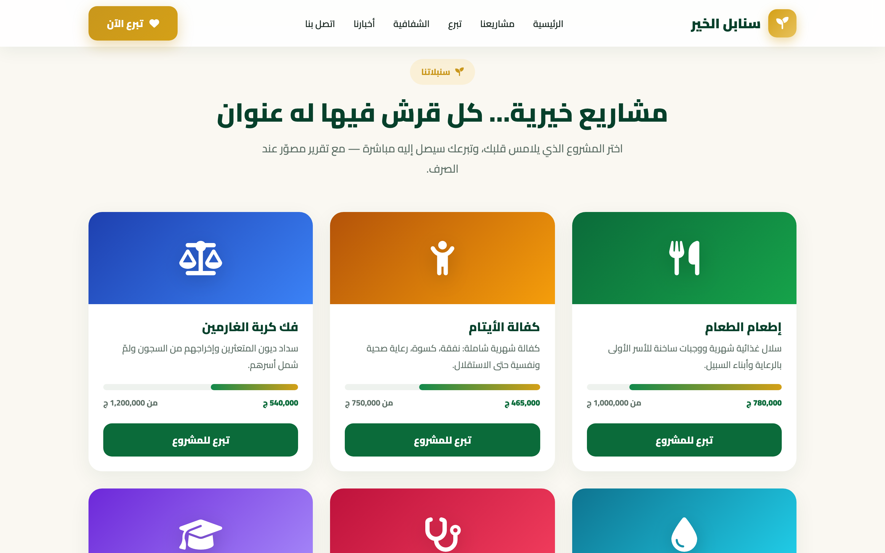
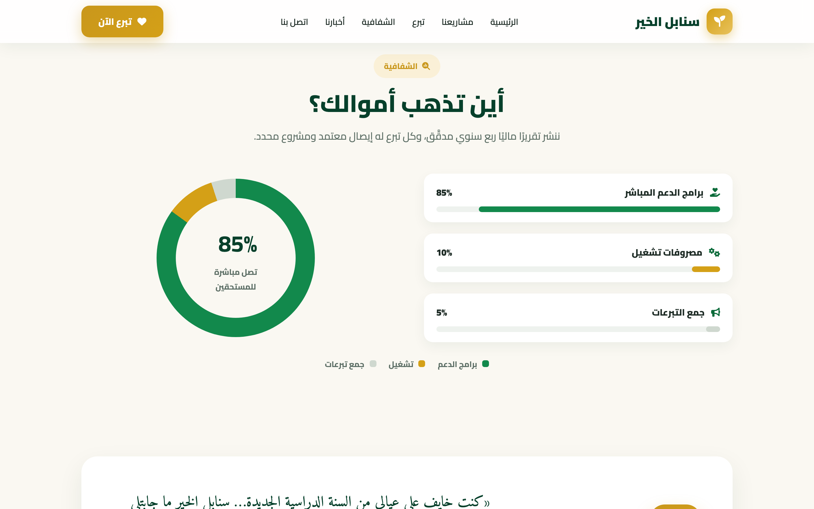
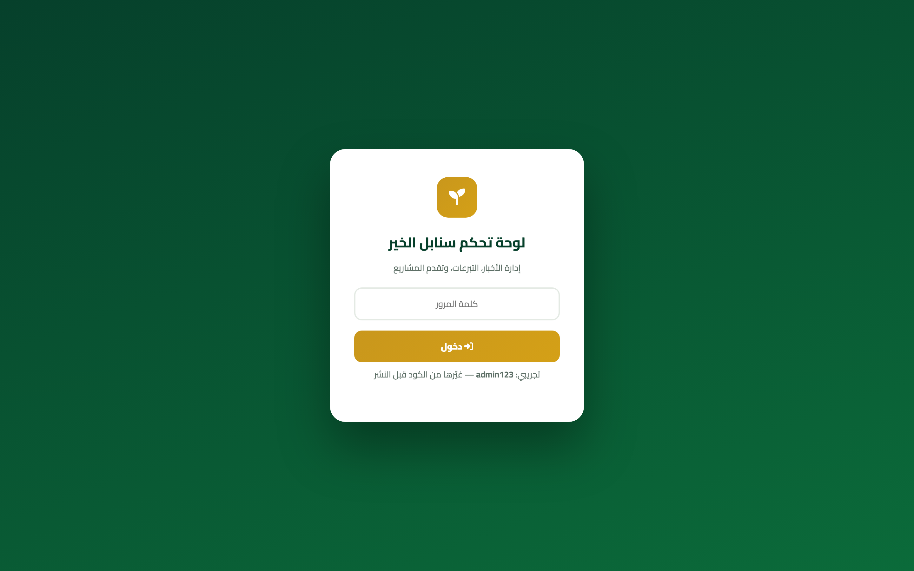
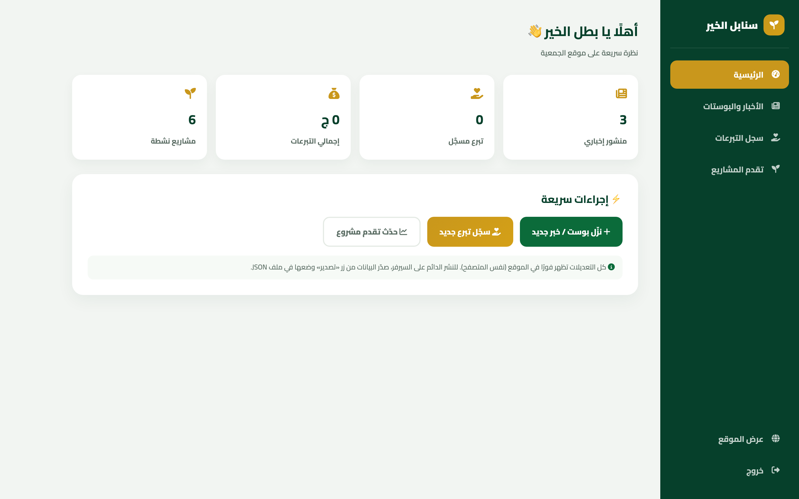
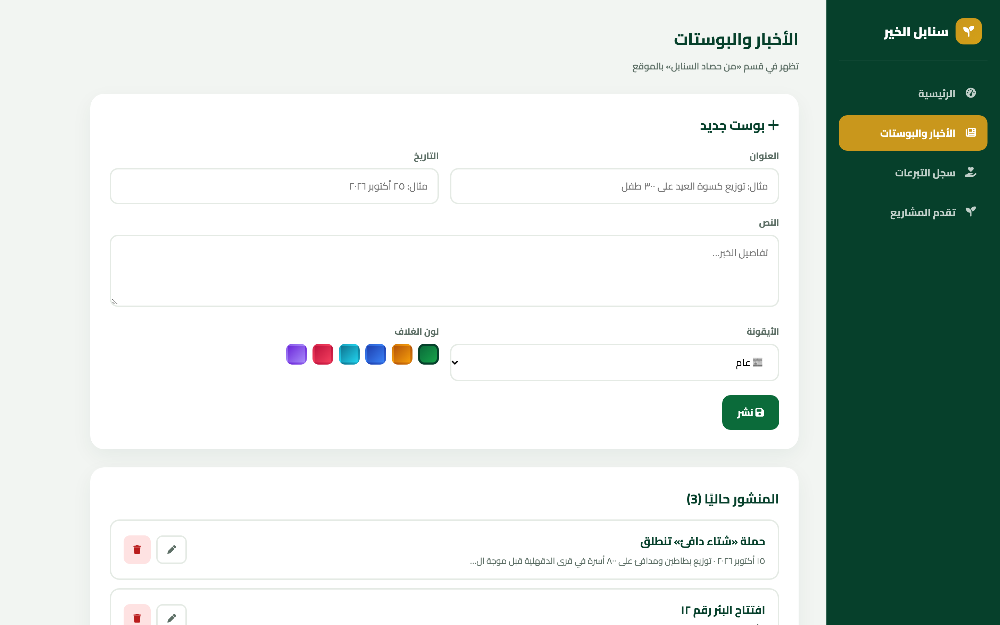

<div align="center">

# 🌾 سنابل الخير — Snabel El-Kher

**«متبرع مش شايف أثر فلوسه… ما بيرجعش تاني.»**

موقع جمعية خيرية احترافي بواجهة عربية RTL، مستوحى من آية السنبلة
﴿كَمَثَلِ حَبَّةٍ أَنبَتَتْ سَبْعَ سَنَابِلَ﴾ — تحويل التبرع من "صندوق مغلق"
إلى **سنابل واضحة**: كل جنيه له مشروع، وكل مشروع له شريط تقدم، وكل تبرع له إيصال.



[](public/index.html)
[](#)
[](public/admin.html)
[](#)
[-FF4444?logo=laravel)](routes/web.php)

</div>

---

## 📖 القصة — ليه الموقع ده موجود؟

الجمعيات الخيرية في مصر عندها مشكلة مزدوجة:

> **المتبرع محتاج يثق… والجمعية محتاجة أدوات تدير بيها محتواها من غير ما تستأجر مبرمج.**

- المتبرع مش عارف فلوسه رايحت فين → **ما بيرجعش يتبرع تاني**.
- الجمعية بتنزل أخبارها على فيسبوك بس → **مفيش موقع رسمي**.
- مفيش طريقة سهلة لتسجيل التبرعات الواردة يدويًا (نقدًا/تحويل/كاش).

**الحل:** موقع من طبقتين — واجهة عامة تدعو للتبرع بثقة، ولوحة تحكم للأدمن ينزل
أخبار ويُسجّل تبرعات ويحدّث تقدم المشاريع… **من غير سيرفر ولا داتابيز — شغال من أول ما تفتحه.**

---

## 📸 الجولة

### 💳 صفحة التبرع — أرقام تنسخها بضغطة + بيانات بنكية كاملة


### 🌾 المشاريع — 6 سنابل، كل واحدة بشريط تقدمها


### 🔍 الشفافية — «أين تذهب أموالك؟»


### 🔐 لوحة الأدمن — دخول بكلمة سر


### 📊 داشبورد الأدمن — إحصائيات لحظية


### 📰 إدارة الأخبار — نزّل بوست… يطلع في الموقع فورًا


---

## ✨ المميزات

### 🏠 الواجهة العامة (`index.html`)
| الميزة | التفاصيل |
|---|---|
| 🕌 **Hero قرآني** | آية السنبلة بخط Amiri + شمس ذهبية عائمة وchips لإحصائيات حية |
| 💳 **تبويبات تبرع** | صدقة / زكاة مال / كفالة يتيم / وقف خيري |
| 🏷️ **مبالغ بأثرها** | كل مبلغ مكتوب جنبه هيعمل إيه: `300 ج = سلة غذائية كاملة` |
| 📲 **أرقام تنسخ بضغطة** | فودافون كاش · إنستا باي · حساب بنكي · IBAN — الضغط ينسخ الرقم |
| 📊 **عدّادات متحركة** | مستفيدين / متطوعين / سنوات خبرة — بتعدّ وهي بتظهر |
| 🌾 **6 مشاريع** | إطعام · أيتام · غارمين · مياه · علاج · تعليم — بأشرطة تقدم |
| 🔍 **قسم شفافية** | Donut chart: 85% برامج، 10% تشغيل، 5% جمع تبرعات |
| 📱 **RTL Responsive** | تصميم عربي كامل، شغال من الموبايل |

### 🔐 لوحة الأدمن (`admin.html`)
| القسم | يعمل إيه |
|---|---|
| 📰 **الأخبار والبوستات** | إضافة / تعديل / حذف بوست (عنوان، تاريخ، نص، أيقونة، لون غلاف) — **يظهر في الموقع فورًا** |
| 💛 **سجل التبرعات** | تسجيل تبرع وارد (اسم، مبلغ، مشروع، طريقة دفع) + **تصدير CSV** |
| 📊 **تقدم المشاريع** | سلايدرز لكل مشروع — الشريط في الموقع يتحدث مباشرة |
|  **حماية** | شاشة دخول بكلمة سر (تجريبية: `admin123`) |

> **التقنية:** اللوحة بتخزن في `localStorage` — مناسبة للعرض والتجربة.
> للبيانات المشتركة بين كل الزوار، الـ scaffold بتاع **Laravel + Filament**
> (`routes/`, `app/`) موجود وجاهز يتوصّل بخلفية حقيقية.

---

## 🏗️ الأركيتيشر

```
snabel-elkher/
├── public/
│   ├── index.html   ← 🏠 الواجهة العامة (RTL — ملف واحد، صفر dependencies)
│   └── admin.html   ← 🔐 لوحة التحكم (أخبار + تبرعات + مشاريع)
├── routes/web.php   ← 🌾 Laravel scaffold جاهز للربط بخلفية حقيقية
├── app/             ← Filament resources + Models (Donation, Volunteer)
├── resources/views/ ← Blade templates مطابقة للتصميم
└── docs/screenshots/
```

**فلسفة الملفين:** `index.html` و `admin.html` بيشاركوا نفس مفاتيح
`localStorage` (`snabel_news`, `snabel_donations`, `snabel_projects`) —
فاللوحة هي "الباك-إند" المؤقت لحد ما Laravel يشتغل.

---

## 🚀 التشغيل

```bash
# أي طريقة تخدم ملفات ثابتة:
cd public
python3 -m http.server 8092
# الموقع:  http://127.0.0.1:8092
# الأدمن:   http://127.0.0.1:8092/admin.html   (admin123)
```

أو ببساطة افتح `public/index.html` في المتصفح مباشرة — **مفيش build، مفيش install**.

### ✏️ بيانات تحتاج تحديث قبل النشر
- [ ] أرقام الحسابات البنكية وIBAN (حاليًا placeholders في `index.html` → `bank-box`)
- [ ] رقم واتساب الاستلام
- [ ] كلمة سر الأدمن (حاليًا `admin123` في `admin.html`)
- [ ] روابط السوشيال ميديا الحقيقية

---

## 🛣️ خارطة الطريق

- [ ] ربط Laravel + Filament (السكافولد موجود) لتخزين مركزي للتبرعات والأخبار
- [ ] بوابة دفع حقيقية (Fawry / Paymob / Instapay API)
- [ ] حاسبة زكاة تفاعلية
- [ ] طباعة إيصال تبرع PDF

---

<div align="center">

**«حَبَّةٌ واحدة… وسبع سنابل لا تنتهي»** 🌾

Built with ❤️ in Egypt · **Ahmed Anter** · [anter-vip](https://github.com/anter-vip)

</div>
